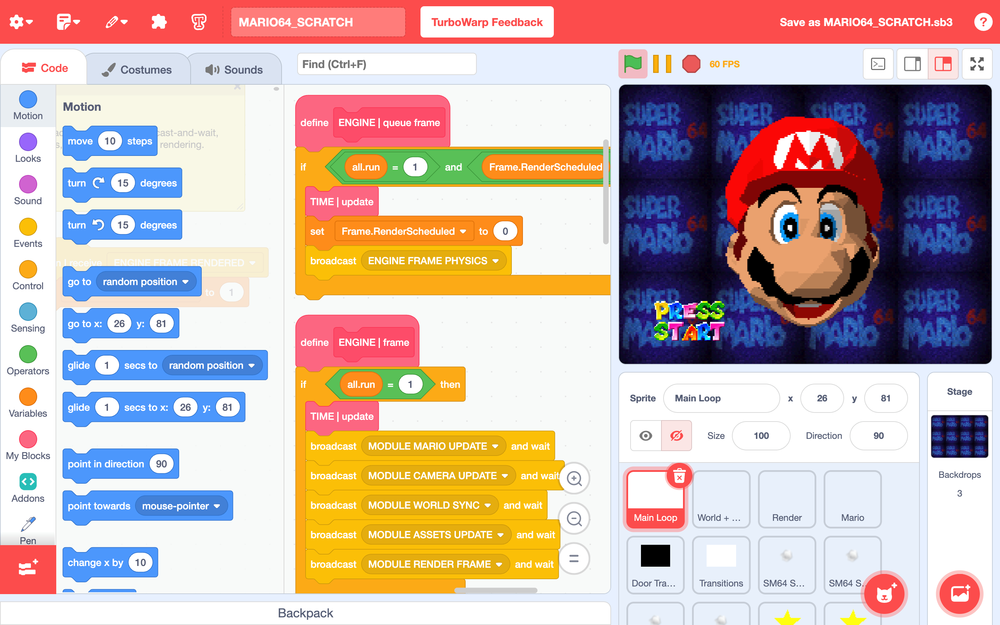

# SM64 Scratch

This is a set of scripts that builds a playable version of Super Mario 64 as a vanilla Scratch `.sb3` project using standard blocks. Run the generated project in TurboWarp.



**A Super Mario 64 (USA) ROM is required.** The scripts read your ROM locally to reconstruct the original game resources and insert them into the Scratch project.

**Initial Beta 0.1.0**

The beta includes Mario's interactive head intro, the castle grounds, parts of the castle interior, and Bob-omb Battlefield. Four Power Stars are currently obtainable:

- The summit star (King Bob-omb's boss fight is not implemented yet).
- Find the 8 Red Coins.
- Behind Chain Chomp's Gate.
- The 100-Coin Star.

This repository includes the source tools and an assetless Scratch template; it does not include a ROM or a ready-to-play build containing Nintendo's assets.

If you enjoy the project, please give [SM64 Scratch](https://github.com/naegoxdev/sm64-scratch) a star! ⭐ Will anyone speedrun all four stars?

> [!NOTE]
> **AI disclosure:** This project was developed with substantial AI assistance to translate and adapt individual functions and systems from the SM64 decompilation into Scratch, and to develop this tool that extracts game assets from a ROM and adds them to the Scratch project.
>
> My work involved choosing and customizing the engine, defining features, providing references, and testing builds. This disclosure concerns this project's development.

## Quick start

You need **Python 3.10+**, the packages listed in `requirements.txt`, and a compatible US ROM. The normalized ROM SHA-1 must be `9bef1128717f958171a4afac3ed78ee2bb4e86ce`; the builder supports `.z64`, `.n64`, and `.v64` byte orders.

Download and extract the repository ZIP, or clone it:

```bash
git clone https://github.com/naegoxdev/sm64-scratch.git
cd sm64-scratch
```

### Windows

**Option 1: build helper**

Double-click `BUILD_WINDOWS.bat`, then enter or drag in the path to your ROM when prompted. The script creates a virtual environment, installs dependencies, and generates the game.

**Option 2: PowerShell commands**

Open PowerShell in the repository folder and run:

```powershell
py -3 -m venv .venv
.\.venv\Scripts\python.exe -m pip install -r requirements.txt
.\.venv\Scripts\python.exe build_game.py --rom "C:\path\to\your\US-ROM.z64"
```

Replace the example ROM path with the path to your own file.

### macOS / Linux

From the repository folder, run:

```bash
python3 -m venv .venv
.venv/bin/python -m pip install -r requirements.txt
.venv/bin/python build_game.py --rom "/path/to/your/US-ROM.z64"
```

Replace the example ROM path with the path to your own file. You can also use the helper to set up the environment and build the game automatically:

```bash
bash BUILD_MAC_LINUX.sh "/path/to/your/US-ROM.z64"
```

## Output and project status

A successful build creates `output/MARIO64_SCRATCH.sb3` and `output/build_report.json`. **Open the `.sb3` in TurboWarp and enjoy :)**

The report status `PLAYABLE_DEMO_INCOMPLETE` means the project is a work in progress; it is not a build error.

See [build instructions and options](docs/building.md) for custom output paths and troubleshooting.

## Playing and limitations

**WASD** to move, **Space** to jump, **X** to attack or dive, **Z** to crouch or ground pound, and arrow keys for the camera. Shift is not needed to run.

- This is a playable beta, not the complete Super Mario 64 game. Other courses and the King Bob-omb boss fight are not implemented.
- Camera behavior, collisions, animations, and transitions can still have bugs.
- Performance depends on your computer and the current scene. TurboWarp is the intended player; compatibility and performance on the Scratch website are not guaranteed.
- The green flag restarts the session and resets collected coins and stars. Persistent progress saving is not implemented.
- `PLAYABLE_DEMO_INCOMPLETE` in the build report describes the beta's scope; it is not a build error.

Bug reports, technical feedback, and contributions are welcome.

## Repository layout

```text
sm64-scratch/
├── build_game.py              # Public command-line entry point
├── BUILD_WINDOWS.bat          # Windows setup and build helper
├── BUILD_MAC_LINUX.sh         # macOS/Linux setup and build helper
├── requirements.txt
├── src/sm64_scratch/
│   ├── build_game.py          # Build orchestration and patch order
│   ├── decoders/             # ROM textures, models, animation, audio, etc.
│   ├── patches/              # Scratch gameplay and presentation patches
│   ├── maintenance/          # Assetless template maintenance
│   ├── paths.py              # Shared repository/resource paths
│   └── ...                   # ROM codec and SB3 packaging helpers
├── config/metadata/          # Extraction and conversion recipes
├── templates/BASE.sb3        # Assetless Scratch logic template
├── tools/                    # Developer command-line helpers
├── docs/                     # Build instructions and architecture
└── output/                   # Generated locally; ignored by Git
```

The JSON recipes describe offsets, lengths, dimensions, formats, checksums, transformations, and calibration values. They are not intended to contain extracted texture, audio, geometry, or animation payloads. The template contains Scratch logic and placeholder/credit media.

See [the architecture guide](docs/architecture.md) for the build pipeline and where to make changes.

## Provenance

SM64 Scratch reimplements selected Super Mario 64 gameplay systems in Scratch. Its logic and behavior were developed with reference to the public Super Mario 64 decompilation by the n64decomp team and contributors: https://github.com/n64decomp/sm64. 

The Scratch 3D renderer builds on the “Concrete Interior [3D]” project by 12zend.

## Third-party rights

Super Mario 64, Mario, Nintendo names and trademarks, and Nintendo game content remain the property of their respective rights holders. This project is unofficial and is not affiliated with, authorized, sponsored, or endorsed by Nintendo. This repository grants no rights to Nintendo content, ROM data, or resources reconstructed from a ROM. Compatibility names and technical identifiers do not imply endorsement.
